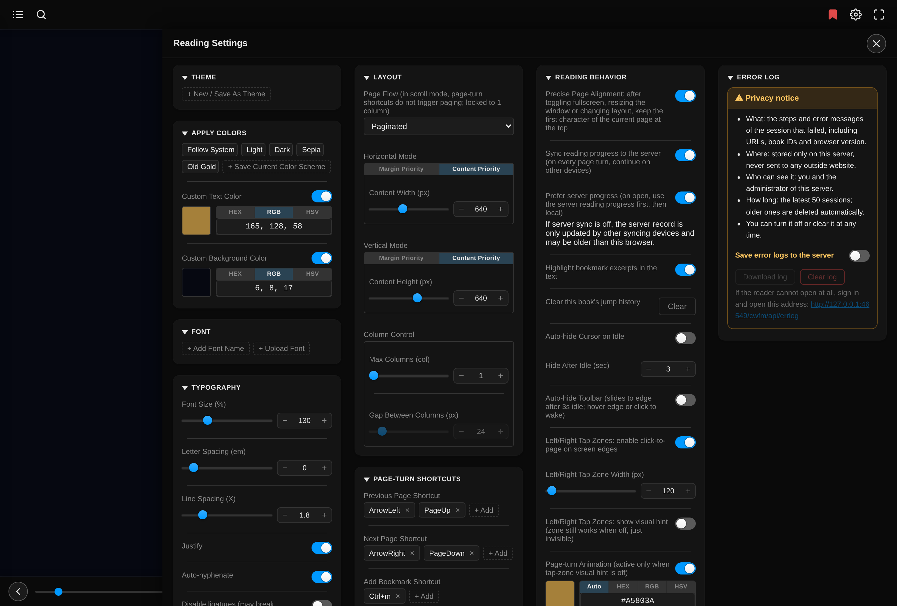
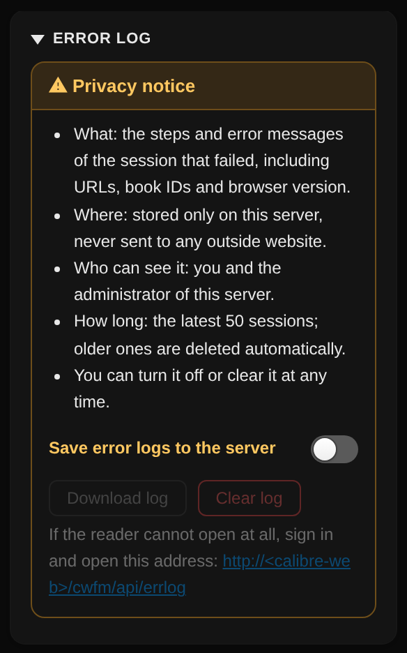

# calibre-web-foliate-docker

**English** | [繁體中文](README.zh.md)

A Docker image of [Calibre-Web](https://github.com/janeczku/calibre-web) with its built-in epub.js reader replaced by a [foliate-js](https://github.com/johnfactotum/foliate-js) reader. It is the server-side version of the [calibre-web-foliate-mod](https://github.com/bgtsai/calibre-web-foliate-mod) Tampermonkey userscript: the same reader, built straight into Calibre-Web, so **no browser extension is needed** — every device that opens an EPUB on your Calibre-Web (desktop, phone or tablet, including iPhone and iPad) gets the new reader automatically. The interface supports Traditional Chinese and English.



## Why this exists

Calibre-Web's built-in epub.js reader has limited typography controls (font size, letter spacing, line spacing, and margins are either missing or imprecise), and its interface can't be customized. foliate-js offers much finer typography control and deep visual customization. The userscript version swaps the reader in the browser, but needs Tampermonkey — which isn't available on iOS. This image does the swap on the server instead, while keeping Calibre-Web's existing bookmark sync and reading-progress mechanisms intact, so your usual workflow stays the same; only the rendering engine and interface change.

## Quick start

**Image**: `ghcr.io/bgtsai/calibre-web-foliate-docker:latest` — [package page (versions, pull command)](https://github.com/bgtsai/calibre-web-foliate-docker/pkgs/container/calibre-web-foliate-docker)

```yaml
services:
  calibre-web-foliate:
    image: ghcr.io/bgtsai/calibre-web-foliate-docker:latest
    container_name: calibre-web-foliate
    environment:
      - PUID=1000
      - PGID=1000
      - TZ=Asia/Taipei
    volumes:
      - /path/to/config:/config
      - /path/to/books:/books
    ports:
      - 8083:8083
    restart: unless-stopped
```

It is based on [linuxserver/docker-calibre-web](https://github.com/linuxserver/docker-calibre-web) and used the same way: if you already run that image, just replace the `image:` line — config and library paths stay the same. Then open any EPUB in Calibre-Web and click the gear icon in the top-right corner to open the settings panel.

## When something goes wrong: error logs and reporting

> [!IMPORTANT]
> **If the reader will not open at all, start here.**
> 1. Sign in to Calibre-Web, then open **`http://<your Calibre-Web address>/cwfm/api/errlog`** to see your own error logs (requires "Save error logs to the server" to be turned on in the settings beforehand).
>    - For example, if you normally open Calibre-Web at `http://192.168.1.100:8083`, type **`http://192.168.1.100:8083/cwfm/api/errlog`** into the address bar.
>    - `<` `>` only mean "replace with your own address" — **do not type them**. The address is the part before the first `/` in the address bar when you use Calibre-Web (an IP with a port, or a domain name such as `https://books.example.com`).
> 2. If even the reader page crashes, add **`?cwfm=safe`** to the reader address: the page skips the reader and shows only the last error log saved in this browser.
>    - For example, if the reader address is `http://192.168.1.100:8083/read/123/epub`, open **`http://192.168.1.100:8083/read/123/epub?cwfm=safe`** instead.



- **Error panel**: when something fails on the reader page, a red "⚠ count" button appears at the bottom left; tap it to see the steps and errors of this session and copy them in one click. Messages that come from browser restrictions and carry no useful detail (such as a `Script error.` without a file name) are not shown.
- **Save error logs to the server (off by default)**: in the "Error log" card at the bottom of the reader settings. The card explains what is recorded, where it is stored, who can see it and for how long, and turning it on asks you to confirm again — **turning it on means you agree that logs are stored on this server (`/config/cwfm.db`, never sent to any outside website) and that you and the server's administrator can see them**. The latest 50 failed sessions are kept per user.
- **Download log** saves a `.txt` with host addresses masked as `<host>` (paths kept), ready to attach to a GitHub issue. **Clear log** deletes only your own logs. Both buttons are disabled while the switch is off; turning the switch off asks whether to delete the logs already on the server.
- **Administrators** can add `?all=1` to the address above to see every user's logs, each labeled with the user name; it only works for Calibre-Web admin accounts.

**Reporting a problem**: open an [issue](https://github.com/bgtsai/calibre-web-foliate-docker/issues), describe what you did and what you saw, and attach the file from **Download log** (or the text from the error panel’s copy-all button (複製全部)). Take one more look before uploading to make sure nothing private is included.

## Features

### Bookmarks: positions, excerpts and notes


- **Add a bookmark** with the bookmark button on the toolbar or **Ctrl+M**. Selected text becomes the excerpt; you can also write a note and a name (leave it empty to name it automatically). When the current page already has a bookmark, the toolbar icon turns red.
- **Three types**: **Position** (red) only marks a place, **Excerpt** (amber) has selected text, and **Note** (teal) has a note — with a small quote badge when it also has an excerpt. While adding or editing, the dialog's frame changes color live to show which type will be saved.
- **In the table of contents**, bookmarks sit under their chapter with a flag that shows the type. The filter buttons on top show only chapters or one bookmark type, with a count for each. Click a bookmark to jump to it; click › on its right — or, with a mouse, just hover — to open a detail card with **Go to**, **Edit**, **Copy link** and **Delete**.
- **In the text**, excerpts are highlighted with a soft background (can be turned off). Tapping a highlight opens the table of contents at that bookmark.
- **Storage**: the Tampermonkey version keeps bookmarks in Tampermonkey's storage; the Docker version keeps them on the server, tied to your Calibre-Web account, so they follow you across devices.

### Search

- The magnifier on the toolbar. Search the text, the bookmarks (names, excerpts and notes), or both.
- Case-insensitive, treats full-width and half-width characters as the same, and **matches Traditional and Simplified Chinese** (searching 書籤 also finds 书签).
- Results are grouped by chapter with surrounding text, position and highlighted keywords. Click a result to jump there; every match in the text is highlighted too.

### Export

- **Export** above the table of contents saves this book's bookmarks as **HTML** (formatted, ready to read or print), **Markdown** or **CSV**, optionally only the types currently filtered. Each entry includes a position link that opens the book right at that spot.

### Position links (preview mode)

- **Copy link** on a bookmark card gives an address that points at that exact character. Opening a book with it enters **preview mode**: it jumps to that spot **without changing your reading progress**. A notice at the top lets you choose **Start reading here** to make it your new reading position.

### Reading progress

- **Always saved locally** on every page turn.
- **Sync reading progress to the server** (on by default): every page turn is synced back to Calibre-Web so you can continue on another device; anything not yet sent is sent when you leave the page.
- **Prefer server progress** (on by default): on open, use the server's progress first, then the local one.
- With precise alignment on, the saved character is placed at the top of the page when the book opens.

### Jump history (back / forward)

- Jumps from the table of contents, bookmarks, in-book links (such as footnote `[284]`), search results and dragging the progress bar all go into **one** history. Use **↩ Back** and **↪ Forward** at the top right of the toolbar (the number shows how many steps are left); up to 50 entries are kept.
- If a jump happens while the toolbar is auto-hidden, a small ↩ ↪ ✕ group floats at the top right so you can get back from a footnote quickly. ✕ only hides it; the history stays.
- Clear this book's jump history under "Reading Behavior" in the settings. With precise alignment on, back and forward return to the first character of that page.

### Typography

- **Font size** 70%–300%, **letter spacing** −0.05em–0.5em, **line spacing** 1×–5×.
- **Justify** and **auto-hyphenate** toggles.
- **Disable ligatures** turns off OpenType ligature substitution. Some fonts use ligatures to convert text (common in display-level Traditional/Simplified Chinese conversion fonts); with custom letter spacing, certain words can look tighter than the text around them. Turning this on evens the spacing, at the cost of the font's substitution features.

> [!TIP]
> Every number field accepts typing, and the **− / +** buttons on either side step the value (hold to repeat). Focus a slider or a number box to fine-tune with the arrow keys or the mouse wheel.

### Layout

- **Page flow**: paginated or scrolled.
- **Horizontal / vertical mode**: margin priority (fixed margins) or content priority (fixed content width / height; margins absorb the rest, so the content keeps its size when you go fullscreen or rotate the screen).
- **Columns**: maximum columns and the gap between them in paginated mode; scrolled mode is always one column.
- **Defaults for first-time users** are calculated per device to look like an e-reader: one column; on computers and tablets, content priority with a content box and font size based on the screen (the farther away you read, the more characters per line); on phones, the text fills the screen. Everything can be adjusted afterwards.

### Themes and colors

- **Themes** save typography, layout and colors under a name for one-click switching; reorder by dragging or overwrite with current settings.
- **Apply colors**: built-in Follow System, Light, Dark, Sepia and Old Gold, plus your own saved schemes; one click fills the custom text and background colors below.
- **Custom colors**: separate switches for text and background (off uses the book's own colors), HEX / RGB / HSV input and a color picker.
- The toolbar and panels switch between dark and light to match the page's actual background.

### Fonts

- Type the name of an installed font, or upload a font file (.ttf / .otf / .woff, stored in the browser's IndexedDB). Reorder the list by dragging.

### Page turning and shortcuts

- Shortcuts for previous page, next page and add bookmark are customizable, with several keys per action (defaults: ← and Page Up, → and Page Down, Ctrl+M). **Page-turn debounce** prevents accidental double turns.
- The mouse wheel turns pages too. While the settings panel is open, shortcuts and the wheel adjust setting values instead.
- **Left/right tap zones**: tap the left or right side to turn pages; the width is adjustable and the visual hint is a separate switch. On computers this is a click zone; **on phones and tablets it works by gesture** — a tap turns the page, while a long press still selects text (even inside the tap zone), and the blank margins outside the content box work too.
- **Page-turn animation**: an arrow plays on the tap zone when turning pages; its color is customizable or follows the text color.

### Fullscreen and auto-hide

- **Fullscreen**: when the browser does not support web fullscreen (for example some third-party browsers on iOS 15), the button is shown disabled and explains why when tapped. In fullscreen on iPad Safari, the toolbar moves aside for the system ✕ button. Editing a bookmark in fullscreen on iPad brings up the on-screen keyboard, which makes the system leave fullscreen; fullscreen is restored when the dialog closes.
- **Auto-hide toolbar** and **hide cursor on idle** are off by default and can be turned on in the settings.

### Interface

- **Loading indicator**: large books show "Loading" with a download percentage instead of a blank screen. The book starts downloading as soon as the page opens, in parallel with loading the reader itself.
- **Settings panel**: columns adapt to the available width and the header stays fixed while scrolling; all icon buttons share one size and style.
- **Language**: Traditional Chinese or English based on the browser's preferred content language, or set manually at the bottom of the settings (reload to apply).

## Differences from the userscript version

The reader is built from the userscript's source at a pinned version, so the features are the same. The differences:

- **Bookmarks and jump history live on the server.** They follow your Calibre-Web account across devices and browsers (stored in `/config/cwfm.db`).
- **Settings are stored per browser and per address.** Settings live in the browser's `localStorage` (uploaded fonts in IndexedDB) instead of Tampermonkey storage. Browsers keep these separately for each address, so opening the same Calibre-Web through two different addresses (e.g. a LAN IP and a domain name) gives you two independent sets of settings. Clearing the browser's site data clears them too.
- **Works on older iPhone / iPad.** The reader is converted at build time so that iOS 15's Safari can run it, with missing built-in functions filled in. Some newer functions used only for PDF are not filled in, so opening PDFs on older iOS may fail.
- **Error panel and server error log.** See [When something goes wrong](#when-something-goes-wrong-error-logs-and-reporting) above.
- **Coexists with the Tampermonkey version.** If the Tampermonkey version (v1.80.5 or later) is also installed, it detects the Docker build and stops itself, so the two never conflict.

## Interface language not as expected?

The interface defaults to Traditional Chinese or English based on your browser's reported "preferred language for web content" — if it starts with `zh`, Chinese is shown; otherwise English. This setting is independent of your browser's own UI language (menus, buttons, etc.) — a browser with a Chinese interface doesn't necessarily report Chinese as the preferred web content language. If the auto-detected result isn't what you want, you can:

- Go to the "語言 / Language" section at the bottom of the settings panel and manually set the display language (a page reload is required for the change to take effect); or
- Adjust your browser's "preferred language for web content" setting (in Firefox: Settings → General → Language → Choose your preferred language for displaying pages, and move Traditional Chinese to the top of the list).

## How it works

The reader code is not duplicated here. When the image is built, it is assembled directly from a pinned commit of [calibre-web-foliate-mod](https://github.com/bgtsai/calibre-web-foliate-mod) (`CWFM_MOD_REF` in the `Dockerfile`):

| File | Description |
|---|---|
| `cps/static/js/cwfm/cwfm-reader.js` | foliate-js engine + reader interface, generated from the mod source by `build/make_reader.py` |
| `cps/templates/read.html` | Patched in place by `build/patch_read_html.py`: the old epub.js reader's scripts and styles are removed; the error panel, loading indicator, early book download and the script above are added; the rest of the page is kept |
| `cps/cwfm_api.py` | Server API for bookmarks, jump history and error logs (`/cwfm/api/`), stored in `/config/cwfm.db` without touching Calibre-Web's own `app.db`; added by `build/patch_calibre_web.py` and registered in `cps/main.py` |
| `cps/templates/login.html` | A small script so that opening a position link while signed out still lands on that position after signing in |

The patch only changes the files in the table: the rest of Calibre-Web (server, other pages, library, bookmarks, users) is untouched. Before writing anything, the patch checks that every anchor it relies on in `read.html` is present exactly once; if an upstream release changes that page, the build stops with an error and the previous image stays in place instead of producing a broken page. The iOS 15 conversion lives in `build/legacy/`, the error panel in `build/error_panel.html`.

The old reader's files remain in the image (other pages may use them); the EPUB reader page simply no longer loads them.

Upgrading the reader: change `CWFM_MOD_REF` in the `Dockerfile` to the mod's new commit SHA and push. The value also serves as a browser cache-busting parameter, so the old file is never served after an upgrade.

## Build status RSS

The image is rebuilt automatically when the upstream `linuxserver/calibre-web` image changes (checked daily at 12:00 Taipei time). Each run posts an item to:

https://raw.githubusercontent.com/bgtsai/calibre-web-foliate-docker/main/build_status.xml

🟢 no upstream update · 🔵 rebuilt and pushed · 🔴 failed (the previous image stays in place).

## License

This project is based on [linuxserver/docker-calibre-web](https://github.com/linuxserver/docker-calibre-web) (GPL v3) and [janeczku/calibre-web](https://github.com/janeczku/calibre-web) (GPL v3), and is released under GPL v3.

foliate-js is released under the MIT license and is included in this project.
