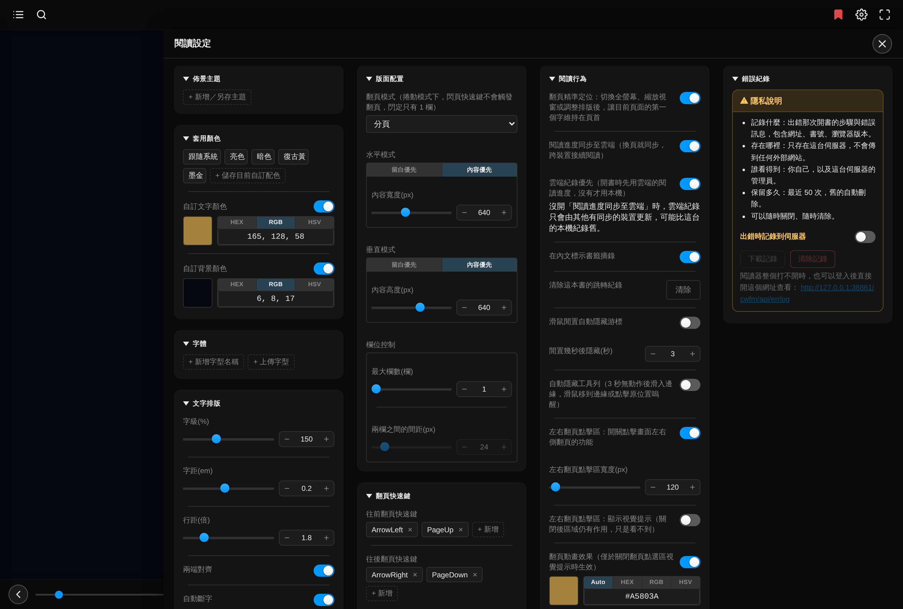
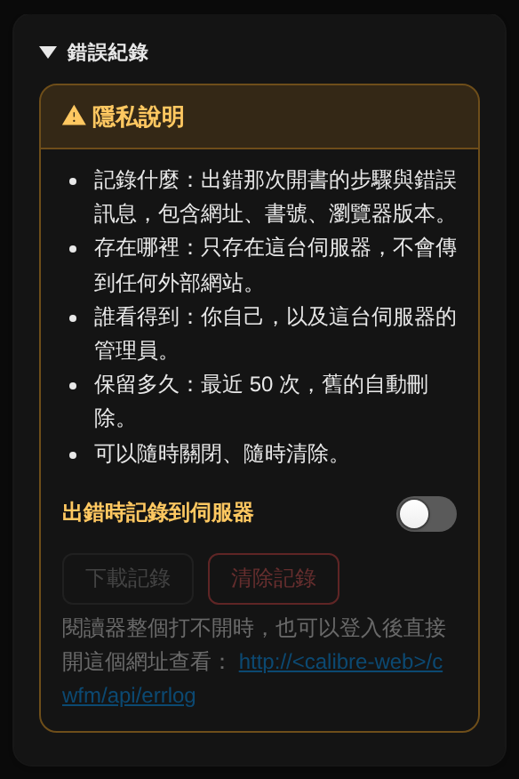

# calibre-web-foliate-docker

[English](README.md) | **繁體中文**

把 [Calibre-Web](https://github.com/janeczku/calibre-web) 內建的 epub.js 閱讀器換成 [foliate-js](https://github.com/johnfactotum/foliate-js) 閱讀器的 Docker image。它是 Tampermonkey 腳本 [calibre-web-foliate-mod](https://github.com/bgtsai/calibre-web-foliate-mod) 的伺服器端版本：同一個閱讀器，直接內建在 Calibre-Web 裡，**不需要在瀏覽器安裝任何外掛**——凡是連到這台 Calibre-Web 的裝置（電腦、手機、平板，包含 iPhone、iPad）打開 EPUB，都會直接使用新的閱讀器。介面支援繁體中文／英文。



## 這是為了什麼寫的

Calibre-Web 內建的 epub.js 閱讀器，排版控制項有限（字級、字距、行距、留白這些細部排版選項都沒有或不夠精準），介面樣式也沒辦法自訂；foliate-js 的排版控制更細緻，可以深度自訂外觀。Tampermonkey 腳本版是在瀏覽器端換掉閱讀器，但必須安裝 Tampermonkey，iOS 上沒辦法用。這個 image 改在伺服器端替換，同時保留 Calibre-Web 原本的書籤同步、閱讀進度這些既有機制，原本習慣的操作方式維持不變，只是排版引擎跟介面換了。

## 快速開始

**鏡像**：`ghcr.io/bgtsai/calibre-web-foliate-docker:latest`——[映像檔倉庫頁面（版本、拉取指令）](https://github.com/bgtsai/calibre-web-foliate-docker/pkgs/container/calibre-web-foliate-docker)

```yaml
services:
  calibre-web-foliate:
    image: ghcr.io/bgtsai/calibre-web-foliate-docker:latest
    container_name: calibre-web-foliate
    environment:
      - PUID=1000
      - PGID=1000
      - TZ=Asia/Taipei
    volumes:
      - /path/to/config:/config
      - /path/to/books:/books
    ports:
      - 8083:8083
    restart: unless-stopped
```

以 [linuxserver/docker-calibre-web](https://github.com/linuxserver/docker-calibre-web) 為基礎，用法相同：如果你原本就在用那個 image，只要把 `image:` 這一行換掉即可，設定檔、書庫路徑都不用改。之後在 Calibre-Web 開啟任一本 EPUB，右上角齒輪圖示可以開啟設定面板。

## 出問題時：錯誤紀錄與回報

> [!IMPORTANT]
> **閱讀器整個打不開時，看這裡。**
> 1. 先登入 Calibre-Web，再打開 **`http://<你的 Calibre-Web 位址>/cwfm/api/errlog`**，就能直接看到自己的錯誤紀錄（需要事先在設定裡開啟「出錯時記錄到伺服器」）。
>    - 例如你平常用 `http://192.168.1.100:8083` 開 Calibre-Web，就在網址列輸入 **`http://192.168.1.100:8083/cwfm/api/errlog`**。
>    - `<` `>` 只是「換成你自己的位址」的意思，**不用打進去**；位址就是你平常開 Calibre-Web 時，網址列裡 `/read/…`、`/book/…` 這類路徑前面的那一段（可能是 IP 加埠號，也可能是網域名稱，例如 `https://books.example.com`）。
> 2. 如果連閱讀頁都當掉，在閱讀頁網址後面加上 **`?cwfm=safe`**：頁面會跳過閱讀器，只顯示上一次留在這台瀏覽器的錯誤紀錄。
>    - 例如閱讀頁網址是 `http://192.168.1.100:8083/read/123/epub`，就改開 **`http://192.168.1.100:8083/read/123/epub?cwfm=safe`**。



- **錯誤面板**：閱讀頁發生錯誤時，左下角會出現紅色「⚠ 數量」按鈕，點開可看到這次的步驟與錯誤，並一鍵複製。瀏覽器本身限制、看了也查不出原因的訊息（例如沒有檔名的 `Script error.`）不會顯示。
- **出錯時記錄到伺服器（預設關閉）**：在閱讀器設定面板最下方的「錯誤紀錄」卡片裡。卡片上寫明了記錄什麼、存在哪裡、誰看得到、保留多久；打開開關時會再請你確認一次——**打開就代表同意：紀錄會存在這台伺服器（`/config/cwfm.db`，不會傳到任何外部網站），你自己和這台伺服器的管理員都看得到**。每人保留最近 50 次出錯的開書紀錄。
- **下載記錄**：存成 `.txt`，主機位址會自動遮成 `<host>`（路徑保留），可以直接附在 GitHub Issue。**清除記錄**只會刪掉你自己的紀錄。開關關閉時這兩顆按鈕會停用；從開切到關時，會問要不要一併清除伺服器上的紀錄。
- **管理員**：在上面的網址後加 `?all=1`，可以看所有使用者的紀錄（每筆標上使用者名稱）；只有 Calibre-Web 管理員帳號有效。

**回報問題**：到 [Issues](https://github.com/bgtsai/calibre-web-foliate-docker/issues) 開一則，描述你做了什麼、看到什麼，並附上〔下載記錄〕存下的檔案（或錯誤面板〔複製全部〕的內容）。上傳前請再看一眼，確認沒有你不想公開的資訊。

## 功能說明

### 書籤：定位、摘錄、備註


- **加入書籤**：工具列的書籤鈕或 **Ctrl+M**。有選取文字時會帶入成「摘錄」，可以另外寫「備註」、自訂名稱（留空就自動命名）。這一頁已經有書籤時，工具列的書籤圖示會變成紅色。
- **三種類型**：只記位置的**定位**（紅）、有選取文字的**摘錄**（琥珀）、有寫備註的**備註**（青綠；同時有摘錄時會多一個引號小徽章）。新增或編輯時，對話框的外框顏色會跟著內容即時變成存下去的類型。
- **在目錄裡**：書籤插在所屬章節底下，用左側尖角的旗頭表示類型。上方的篩選鈕可以只看章節或某一類書籤，數字是該類的數量。點書籤本體直接跳過去；點右側 › 或（有滑鼠時）滑鼠移上去，會在旁邊彈出詳細卡片，可以〔前往〕〔編輯〕〔複製連結〕〔刪除〕。
- **在內文裡**：有摘錄的書籤會在內文用淡底色標示（可在設定關閉），點標示會打開目錄並指到那張書籤。
- **儲存**：Tampermonkey 版存在 Tampermonkey 的儲存空間；Docker 版存在伺服器，跟著 Calibre-Web 帳號走，換裝置也看得到。

### 搜尋

- 工具列的放大鏡。可以只搜內文、只搜書籤（名稱、摘錄、備註），或全部一起搜。
- 不分大小寫、全形半形視為相同，而且**簡繁互通**（例如搜「書籤」也找得到「书签」）。
- 結果依章節分組、附前後文與位置百分比，關鍵字標亮；點結果跳過去，內文所有命中處也會標示出來。

### 匯出

- 目錄上方的〔匯出〕，可以把這本書的書籤匯出成 **HTML**（排好版、可直接閱讀或列印）、**Markdown** 或 **CSV**，並可只匯出目前篩選的類型。每筆都附「定位連結」，點了會直接打開到那個位置。

### 定位連結（預覽模式）

- 書籤卡片的〔複製連結〕會產生一條指到「那一個字」的網址。用這條網址開書會進入**預覽模式**：直接跳到該位置，但**不會改動你的閱讀進度**；畫面上方會提示，按〔正式閱讀〕才把這裡當成新的閱讀位置。

### 閱讀進度

- **本機一律記錄**，每次換頁就記住位置。
- **閱讀進度同步至雲端**（預設開）：每次換頁就同步回 Calibre-Web，換裝置也能接著讀；離開頁面時會把還沒送出的進度補送。
- **雲端紀錄優先**（預設開）：開書時先用雲端的進度，沒有才用本機的。
- 開書時，進度所在的那個字會對齊在頁首（翻頁精準定位開啟時）。

### 跳轉紀錄（上一步／下一步）

- 從目錄、書籤、書內連結（例如註解 `[284]`）、搜尋結果跳轉，或拖動進度條，都記在**同一份**紀錄裡，用工具列右上的 **↩ 上一步**、**↪ 下一步** 來回（圖示上的數字是還能走幾步），最多保留 50 筆。
- 工具列自動隱藏時才發生的跳轉，畫面右上角會浮出一組小的 ↩ ↪ ✕，方便在看註解時跳回原處；按 ✕ 只是收起來，紀錄還在。
- 清除這本書的跳轉紀錄在設定面板的「閱讀行為」。翻頁精準定位開啟時，每次上一步／下一步都會回到當時頁面的第一個字。

### 文字排版

- **字級**：70%～300%。**字距**：−0.05em～0.5em。**行距**：1 倍～5 倍。
- **兩端對齊**、**自動斷字**：開關切換。
- **關閉連字**：停用字型的 OpenType 連字替換。適用於用連字機制做文字轉換的字型（常見於顯示層簡繁轉換字型）——這類字型搭配自訂字距時，特定詞彙的字距可能明顯比周圍窄；開啟後字距均勻，代價是字型的替換功能會一併停用。

> [!TIP]
> 所有數值欄位都可以直接輸入，也可以用兩側的 **−／＋** 增減（按住可連續增減）。點一下滑桿或數值框取得焦點後，也能用方向鍵或滑鼠滾輪微調。

### 版面配置

- **翻頁模式**：分頁或捲動。
- **水平／垂直模式**：留白優先（固定留白）或內容優先（固定內容寬度／高度，留白自動吸收剩餘空間，切換全螢幕、旋轉螢幕時內容大小不變）。
- **欄位控制**：分頁模式下設定最大欄數與欄間距；捲動模式固定 1 欄。
- **第一次使用的預設排版**會依裝置自動算出接近電子閱讀器的樣子：單欄；電腦與平板用「內容優先」、依螢幕大小決定內容框與字級（越遠看的裝置一行放越多字）；手機則填滿畫面。之後可以隨意調整。

### 佈景主題與配色

- **佈景主題**：把排版、版面與顏色另存成具名主題，一鍵切換，可拖曳排序、覆蓋更新。
- **套用顏色**：內建跟隨系統、亮色、暗色、復古黃、墨金，加上自己存的配色；點一下就把文字色與背景色填入下方自訂欄位。
- **自訂顏色**：文字與背景各一個開關（關閉就用書本自己的顏色），支援 HEX／RGB／HSV 與取色器。
- 工具列、面板會依書頁實際的背景色自動切換深色或淺色。

### 字型

- 可輸入系統已安裝的字型名稱，或直接上傳字型檔（.ttf／.otf／.woff，存在瀏覽器的 IndexedDB）。清單可拖曳排序。

### 翻頁與快速鍵

- 上一頁／下一頁、加入書籤的快速鍵都可自訂，每個動作可錄多組按鍵（預設：← 與 Page Up、→ 與 Page Down、Ctrl+M）。**翻頁防彈跳**避免連續誤觸。
- 滑鼠滾輪也能翻頁。設定面板開著時，快速鍵與滾輪改用來調整設定數值。
- **左右翻頁點擊區**：點畫面左右兩側翻頁，寬度可調，可另外決定要不要顯示提示框。電腦上是一塊點擊區；**手機、平板上改用手勢判斷**——點一下才翻頁，長按照樣可以選字（翻頁區範圍內也可以），內容框外的留白也能點。
- **翻頁動畫**：翻頁時在點擊區播放方向箭頭，顏色可自訂或跟隨文字色。

### 全螢幕與自動隱藏

- **全螢幕**：瀏覽器不支援網頁全螢幕時（例如 iOS 15 上的部分第三方瀏覽器），按鈕會顯示成停用，點了會說明原因。iPad Safari 全螢幕時，工具列左側會讓開系統的 ✕ 按鈕。在 iPad 全螢幕中編輯書籤時，螢幕鍵盤出現會讓系統退出全螢幕；關閉對話框時會自動回到全螢幕。
- **自動隱藏工具列**、**滑鼠閒置自動隱藏游標**：預設都關閉，可在設定開啟。

### 介面

- **載入提示**：打開大本的書時，畫面會先顯示「正在載入書籍」與下載百分比，不會只看到一片空白。書檔會在頁面一打開就開始下載，跟閱讀器程式的載入同時進行。
- **設定面板**：依可用寬度自動分欄，捲動時標題列固定；所有圖示按鈕同一套尺寸與樣式。
- **語言**：依瀏覽器的網頁內容偏好語言自動顯示繁體中文或英文，也可在設定最下方手動指定（需重新整理）。

## 與 Tampermonkey 腳本版的差異

閱讀器程式取自腳本版指定版本的原始碼，功能相同。差別在於：

- **書籤與跳轉紀錄存在伺服器。** 跟著 Calibre-Web 帳號走，換裝置、換瀏覽器都看得到（資料在 `/config/cwfm.db`）。
- **設定依瀏覽器、依網址分開存放。** 設定存在瀏覽器的 `localStorage`（上傳的字型存在 IndexedDB），不是 Tampermonkey 的儲存空間。瀏覽器會依網址分開保存，所以用兩個不同網址開同一台 Calibre-Web（例如區網 IP 與網域名稱），會是兩份各自獨立的設定；清除瀏覽器的網站資料時，設定也會一併清除。
- **舊版 iPhone／iPad 也能用。** 建置時會把閱讀器轉成 iOS 15 的 Safari 也能執行的版本，並補上缺少的內建函式。部分只有 PDF 才會用到的新函式沒有補，舊版 iOS 開 PDF 可能出錯。
- **錯誤面板與伺服器錯誤紀錄。** 見上方〈[出問題時：錯誤紀錄與回報](#出問題時錯誤紀錄與回報)〉。
- **跟 Tampermonkey 版並存。** 瀏覽器裡同時裝著 Tampermonkey 版（v1.80.5 以上）也沒關係：它偵測到這是 Docker 版會自動停止，不會互相干擾。

## 介面語言顯示不符預期？

介面預設依瀏覽器回報的「網頁內容偏好語言」自動判斷（開頭是 `zh` 就顯示繁體中文，其他一律顯示英文）。這組設定跟瀏覽器本身的**介面顯示語言**（選單、按鈕這些）是兩個各自獨立、可以不一樣的設定。如果自動判斷的結果不是你要的，可以：

- 到設定面板最下方的「語言 / Language」分組，手動指定要顯示的語言（切換後需要重新整理頁面才會生效）；或
- 調整瀏覽器本身「網頁內容偏好語言」的設定（以 Firefox 為例：設定 → 一般 → 語言 → 選擇偏好語言以顯示網頁，把繁體中文排到清單最上面）。

## 運作方式

閱讀器程式碼不另存副本，建置 image 時直接從 [calibre-web-foliate-mod](https://github.com/bgtsai/calibre-web-foliate-mod) 的指定 commit（`Dockerfile` 的 `CWFM_MOD_REF`）組裝：

| 檔案 | 說明 |
|---|---|
| `cps/static/js/cwfm/cwfm-reader.js` | foliate-js 引擎 + 閱讀器介面，由 `build/make_reader.py` 從 mod 原始碼產生 |
| `cps/templates/read.html` | 由 `build/patch_read_html.py` 就地修改：移除舊 epub.js 閱讀器的腳本與樣式，加入錯誤面板、載入提示、提早下載書檔與上面這支程式；頁面其餘結構保留 |
| `cps/cwfm_api.py` | 書籤、跳轉紀錄、錯誤紀錄的伺服器 API（`/cwfm/api/`），資料存在 `/config/cwfm.db`，不動 Calibre-Web 自己的 `app.db`；由 `build/patch_calibre_web.py` 放進去並在 `cps/main.py` 註冊 |
| `cps/templates/login.html` | 加一小段腳本：沒登入就點了定位連結時，登入後仍會回到那個位置 |

只改上表這些檔案，Calibre-Web 其餘部分（伺服器端、其他頁面、書庫、書籤、使用者管理）完全不動。修改 `read.html` 之前，會先確認它依賴的每個錨點都剛好出現一次，全部通過才寫入；如果上游改版動到這一頁、對不上了，建置會直接失敗，image 維持上一版，不會產出壞掉的頁面。iOS 15 相容轉換在 `build/legacy/`，錯誤面板在 `build/error_panel.html`。

舊閱讀器的檔案本身仍留在 image 裡（其他頁面可能用到），只是 epub 閱讀頁不再載入。

升級閱讀器：把 `Dockerfile` 的 `CWFM_MOD_REF` 改成 mod 新的 commit SHA 並推送即可。這個值同時當作瀏覽器快取破壞參數，換版後不會讀到舊檔。

## 建置狀態 RSS

每天台灣時間 12:00 檢查上游 `linuxserver/calibre-web`，有新版就自動重新建置。每次執行都會在下面這個 RSS 新增一則：

https://raw.githubusercontent.com/bgtsai/calibre-web-foliate-docker/main/build_status.xml

🟢 上游無更新 · 🔵 已更新建置 · 🔴 失敗（image 維持上一版）。

## 授權

本專案基於 [linuxserver/docker-calibre-web](https://github.com/linuxserver/docker-calibre-web)（GPL v3）與 [janeczku/calibre-web](https://github.com/janeczku/calibre-web)（GPL v3），以 GPL v3 授權釋出。

foliate-js 以 MIT 授權釋出，已包含在本專案中。
